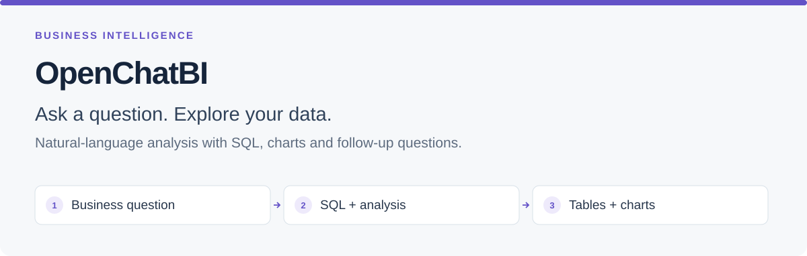
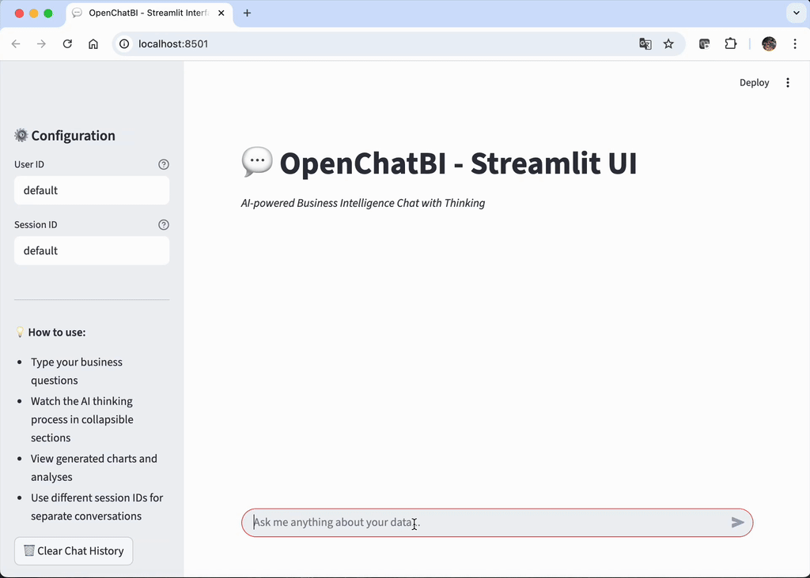
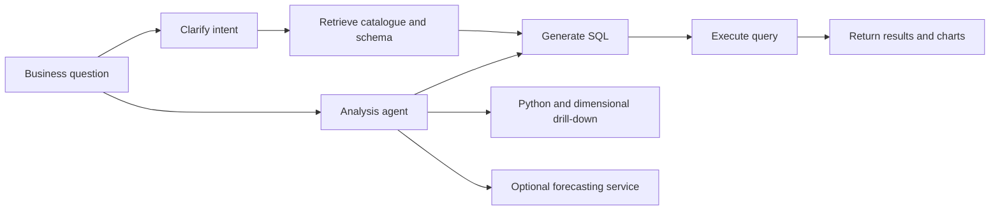

<div align="center">



# OpenChatBI

**From a business question to SQL, charts and deeper analysis.**

[Demo](#demo) · [Workflow](#how-it-works) · [Run locally](#run-locally) · [Evaluation](#evaluation)

Python · LangGraph · Text-to-SQL · Plotly · Streamlit

</div>

## Overview

An open-source conversational BI application that connects natural-language questions to a data catalogue, generates SQL and presents results through a chat interface. Built with Python, LangGraph and LangChain, with a dedicated agent for multi-step analysis.

Based on [OpenChatBI by Yu Zhong](https://github.com/zhongyu09/openchatbi), with the original project attribution and MIT licence retained.

## Demo

<p align="center">
  
</p>

*Application demo supplied by the upstream OpenChatBI project.*

## The business workflow

A business question often depends on more than a table name. OpenChatBI combines database structure with descriptions, metric definitions and query examples so an agent can work with the language used by a business.

| Business need | What the application provides |
| --- | --- |
| Ask a question without writing SQL | Schema selection, SQL generation and database execution |
| Understand the result | Tabular results and Plotly visualisations |
| Use the right business definitions | A configurable catalogue of tables, columns, glossary terms and SQL examples |
| Investigate a change | A dedicated analysis agent with Python analysis and dimensional drill-down |
| Add forecasting and anomaly detection | Optional tools backed by a separately configured forecasting service |
| Inspect and improve behaviour | Optional SQL audit logs, tracing, confidence review and evaluation workflows |

The bundled SQLite example covers customers, orders, products, invoices and shipments. Example questions include:

- “Count orders by status.”
- “Show daily order volumes over a specified date range.”
- “Which product categories have the most orders?”

Results depend on the selected model, catalogue and data.

## How it works



The SQL workflow can retry recoverable execution errors and optionally request human review of low-confidence results. The confidence gate is **after execution** in the current documented workflow.

| Component | Implementation |
| --- | --- |
| Agent orchestration | LangGraph, LangChain and DeepAgents |
| Data access | SQLAlchemy-backed database connections |
| Catalogue retrieval | Embeddings or a BM25 fallback |
| User interfaces | Sample Streamlit and Gradio applications |
| Application integration | Sample FastAPI streaming endpoint and configurable MCP tools |
| Analysis and charts | pandas, Python analysis tools and Plotly |
| Conversation persistence | LangGraph checkpointing with SQLite |
| Python execution | Local, RestrictedPython or Docker execution modes |

See the [core agent](openchatbi/agent_graph.py), [SQL workflow](openchatbi/text2sql/sql_graph.py) and [analysis package](openchatbi/analysis/README.md).

## Run locally

**Requirements:** Python 3.11+, `uv`, access to an LLM provider and the credentials required by your chosen model configuration. The example configuration uses Docker for Python execution, so start Docker before using that mode.

### 1. Install this repository

```bash
git clone https://github.com/nwk0112-collab/Open-ChatBI.git
cd Open-ChatBI
uv sync
```

### 2. Configure the sample dataset

```bash
cp example/config.yaml openchatbi/config.yaml
```

Edit `openchatbi/config.yaml` and replace the placeholder API key for each configured model. Choose model names available to your provider account. Keep credentials out of version control.

The sample uses [tracking_orders.sqlite](example/tracking_orders.sqlite). To run without an embedding model, remove the `embedding_model` section; catalogue retrieval will use BM25. Embedding-dependent memory tools will then be unavailable.

### 3. Start the interface

```bash
uv run python run_streamlit_ui.py
```

Open [localhost:8501](http://localhost:8501) and ask a question about the sample data.

For a separate configuration file:

```bash
export CONFIG_FILE=/absolute/path/to/config.yaml
uv run python run_streamlit_ui.py
```

Other entry points are the [CLI](run_cli.py), [Gradio interface](sample_ui/streaming_ui.py) and [FastAPI example](sample_api/async_api.py).

## Connect your own data

1. Set the warehouse connection and SQL dialect in the [configuration template](openchatbi/config.yaml.template).
2. Provide table descriptions, business definitions and query examples in the catalogue.
3. Check representative questions against known SQL and expected results.
4. Enable the observability and review options needed for your environment.

The warehouse execution connection and catalogue persistence connection are configured independently. The catalogue supports file storage or a SQLAlchemy database backend.

Use a read-only, non-superuser database account. The optional application-layer SQL guard is an additional control; it does not replace database permissions.

## Evaluation

Two different workflows are included:

| Workflow | What it checks | Requirements |
| --- | --- | --- |
| [RunLedger replay](evals/runledger/README.md) | Recorded agent/tool protocol behaviour | Evaluation dependencies; no live LLM or warehouse access in replay mode |
| [LLM-as-Judge](evals/judge/README.md) | Generated SQL against hand-written gold SQL | A configured database and live LLM credentials |

Run the deterministic replay suite:

```bash
uv run --extra eval runledger run evals/runledger --mode replay --baseline baselines/runledger-openchatbi.json
```

For SQL-quality evaluation, collect SQL from the real agent first, then run the judge. Judge smoke mode uses gold SQL on both sides and does not measure agent accuracy.


## Current scope

- The package is marked **beta**. Analysis orchestration, anomaly detection and drill-down continue to be refined.
- Forecasting and anomaly-detection tools are registered only when the forecasting service is healthy.
- Audit logging, tracing, confidence review and learned SQL memory are optional configuration features.
- Python execution mode matters: local execution runs in the current process, and Docker mode can fall back to local execution when Docker is unavailable.
- The included web interfaces and API are sample integration starting points.

## Technical reference

[Full reference documentation](PROJECT_REFERENCE.md) preserves the original detailed guide.

<details>
<summary><strong>Configuration, analysis, evaluation and development</strong></summary>

| Topic | Reference |
| --- | --- |
| Configuration fields | [Configuration template](openchatbi/config.yaml.template) |
| Catalogue and business context | [Catalogue documentation](docs/source/catalog.rst), [example metadata](example/table_info.yaml), [SQL examples](example/sql_example.yaml) |
| Catalogue migration | [Migration utility](openchatbi/catalog/migrate.py) |
| Analysis agent and algorithms | [Analysis package guide](openchatbi/analysis/README.md) |
| Forecasting service setup | [Forecasting guide](timeseries_forecasting/README.md) |
| SQL confidence evaluation | [Confidence evaluator](openchatbi/text2sql/confidence.py) |
| Observability | [Audit, tracing and metrics modules](openchatbi/observability) |
| Replay and SQL-quality evaluation | [RunLedger guide](evals/runledger/README.md), [Judge guide](evals/judge/README.md) |
| Tests | [Testing guide](tests/README.md) |
| Dependencies | [Python project configuration](pyproject.toml) |
| Contributing | [Contribution guidelines](CONTRIBUTING.md) |

</details>

## Licence and acknowledgements

Released under the [MIT Licence](LICENSE). Original copyright: **© 2025 Yu Zhong**.

This repository is based on [zhongyu09/openchatbi](https://github.com/zhongyu09/openchatbi). The existing demo and project implementation originate from that open-source project and its contributors. The sample database is identified in the project documentation as the Spider `tracking_orders` dataset.

For this repository, use [local issues](https://github.com/nwk0112-collab/Open-ChatBI/issues). For the original project and its community, visit the [upstream repository](https://github.com/zhongyu09/openchatbi).
